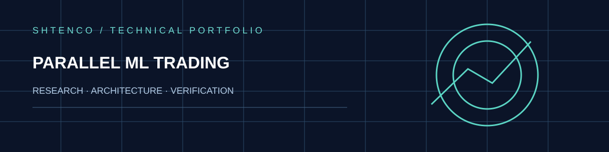
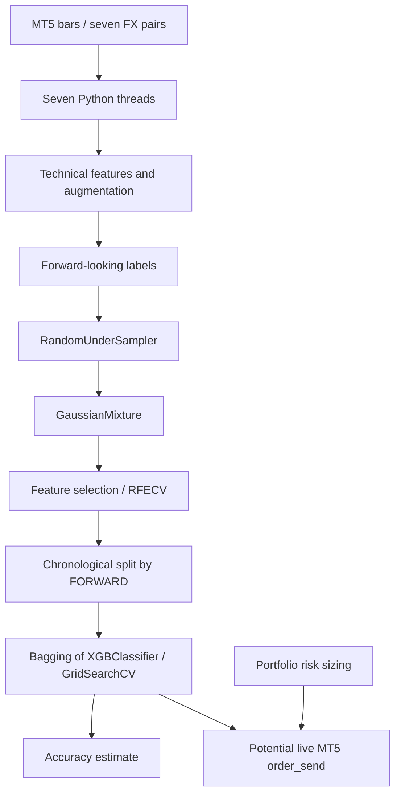

<div align="center">



**PARALLEL ML TRADING / MT5 RESEARCH**

Многопоточная обработка рыночных данных, признаки, XGBoost/Bagging, GMM и риск-управление: аудит исходного кода и научная программа исправлений.

[Архитектура](#реальная-архитектура) · [Формулы](#математическая-модель) · [Проблемы](#выводы-аудита) · [Валидация](#требования-к-проверке) · [Запуск](#запуск)

</div>

> **Статус: экспериментальный торговый код с возможностью передачи реальных приказов через MT5. Не использовать на финансируемом счёте без независимой проверки.** Опубликованные исторические проценты точности не воспроизведены на sealed out-of-sample данных.

## Инженерная задача

Проект исследует объединение семи валютных инструментов в параллельном вычислительном потоке. Для каждого символа код получает данные MT5, рассчитывает широкий набор технических, статистических и объёмных признаков, формирует будущие метки, балансирует выборку, кластеризует данные GaussianMixture, выполняет RFECV и обучает ансамбль XGBoost/Bagging. Отдельные процедуры определяют размеры позиций и взаимодействуют с торговым терминалом.

Профессиональная ценность текущей реализации — демонстрация многокомпонентного ML-конвейера и интеграции с торговым API; production-safe исполнение и реальное predictive superiority требуют отдельного доказательства.

## Реальная архитектура



Функции в [главном исходнике](Multi-Threaded%20Trading%20Robot%20with%20Machine%20Learning.py): `retrieve_data`, `augment_data`, `markup_data`, `label_data`, `generate_new_features`, `cluster_features_by_gmm`, `feature_engineering`, `train_xgboost_classifier`, `calculate_portfolio_position_sizes`, `online_trading`, `process_symbol`.

В отличие от фонового расчёта индикаторов, `online_trading` содержит **прямой вызов `mt5.order_send`**. Это означает, что риск использования кода не ограничен исследовательской отчётностью.

## Математическая модель

Метка роста в `markup_data` задаётся условием абсолютного движения:

$$
y_t=\mathbf{1}\{C_{t+1}>C_t+\delta\},\quad \delta=0.00002.
$$

Это **ценовое изменение**, а не относительная доходность; применение одной абсолютной величины к JPY и остальным валютным инструментам не обеспечивает сопоставимой значимости. Конечное наблюдение при `shift(-1)` требует отдельного удаления, а не присвоения нулевой метки.

В `label_data` будущий горизонт выбирается случайно от 2 до 72 строк, поэтому для одного и того же датасета без фиксированного seed могут формироваться разные метки. Дополнительно используются максимумы и минимумы фрагмента будущих цен. Горизонты индексации должны быть точно определены, поскольку OHLC текущей свечи и следующей свечи имеют различные моменты доступности.

Планируемый риск на один инструмент при портфельном бюджете $R$ и числе инструментов $N$:

$$
R_i=\frac{R}{N}.
$$

Размер позиции в лотах при стопе шириной $D$ **в единицах цены**, размере тика $\tau$, стоимости тика $v$ **в валюте счёта на один лот**:

$$
q_i=\frac{R_i}{(D/\tau)\,v}.
$$

Это корректная размерная формула при неизменном tick value, линейном контракте и отсутствии gap/slippage. В исходнике вместо неё используется `300 * trade_tick_value` без учёта `trade_tick_size`; `300` именуется пипсами, но `order_send` задаёт стоп в **350 `symbol_info.point`**, а не в 300 пипсов. Фактический риск может отличаться от заявленного. Минимальный разрешённый лот принудительно подставляется даже тогда, когда он превышает бюджет риска.

## Выводы аудита

| Уровень | Подтверждённая проблема | Последствие |
|:--|:--|:--|
| P0 | `process_data` выполняет undersampling, GMM и RFECV **до** хронологического train/test | Утечка информации из тестового периода |
| P0 | `RFECV(cv=5)` и `GridSearchCV(cv=5)` используют обычную K-fold вместо purged temporal splits | Перекрывающиеся будущие цели и optimistically biased accuracy |
| P0 | `process_data(raw_data)` вызывает `label_data(..., SYMBOL)`, где глобальный `SYMBOL="EURUSD"` | Для остальных шести инструментов размер стопа/тейка определяется спецификацией EURUSD |
| P0 | `online_trading` повторно использует `test_features.values`, включая исторические строки | Live inference не основан на новом последнем баре |
| P0 | `mt5.order_send` передаётся из нескольких потоков без единого арбитра исполнения | Возможны race conditions по глобальному риску и количеству открытых сделок |
| P0 | Размер позиции рассчитан из 300 `trade_tick_value`, а реальный SL задаётся 350 `point` | Риск на сделку и на портфель не ограничен заявленной формулой |
| P1 | Условие спреда делит на `point`, но результат подписывает как «пипсы» | Ошибка интерпретации размерности |
| P1 | Нет жёсткого запрета на увеличение риска после округления лота к минимуму брокера | Бюджет может быть превышен |
| P1 | `GaussianMixture(n_components=30)` требует достаточной выборки и может стать неустойчивой | Обучение и кластеризация могут не сойтись |
| P1 | Ограничение числа позиций и глобальные `SYMBOL_TRADES` читаются/меняются без общей блокировки | Неатомарный контроль количества позиций |
| P1 | В коде предусмотрены десятки тысяч повторов `order_send` при ошибках | Риск длительной повторной отправки приказов |
| P2 | XGBoost/Bagging использует `subsample=0.01` и `colsample_bytree=0.1` без ablation | Возможная высокая дисперсия / недообучение |
| P2 | Нет сохранённых OOS-артефактов и запускаемых тестов в текущем корневом дереве | Не подтверждена статистическая и торговая эффективность |

**Важная граница:** `accuracy` относится к классификации искусственных меток и не равна вероятности прибыльной сделки. Из-за отбора примеров и временной утечки её нельзя интерпретировать как независимый показатель качества прогнозирования.

## Требования к проверке

1. Заморозить исходный набор котировок, торговую сессию, часовой пояс, параметры инструментов и SHA256 данных.
2. Создавать строго причинные метки и обучать все преобразования (GMM, undersampling, RFECV, модель) только на train внутри каждого fold.
3. Использовать purged walk-forward с gap не меньше максимального горизонта цели, а затем sealed test.
4. Сравнить с majority-class, momentum, logistic regression и простыми деревьями на одном тесте.
5. Ввести единственный order executor с блокировкой портфельного риска, повторной сверкой `positions_get`, `order_check` и расчётом потерь через `order_calc_profit`.
6. Проверить slippage, комиссии, margin, stop-out, limit-open-trades, повторные сделки и аварийное отключение терминала.
7. Публиковать confusion matrix, calibration, net PnL, max drawdown, экспозиции, оборот, доверительные интервалы и сравнение с базовой стратегией.

## Запуск

```bash
git clone https://github.com/Shtenco/multi_threaded_trading_robot_with_machine_learning_python.git
cd multi_threaded_trading_robot_with_machine_learning_python
python -m pip install numpy pandas MetaTrader5 scikit-learn imbalanced-learn xgboost
python "Multi-Threaded Trading Robot with Machine Learning.py"
```

В исходнике задан Windows-путь `C:\Program Files\RoboForex MT5 Terminal\terminal64.exe`. Код способен отправлять реальные приказы: **не запускать на торговом счёте до выделения безопасного исследовательского режима**. Команды описывают зависимости по импортам, но не являются протоколом успешного выполнения.

## Технический вывод

Исходная система объединяет признаки, ансамблевое обучение, семисимвольную многопоточность и торговые API. Это полезное архитектурное основание для разработки количественной лаборатории. Однако нынешний порядок ML-операций и контроль исполнения не соответствуют требованиям честного OOS и безопасного промышленного торгового движка. Приоритет развития — причинная валидация и независимый портфельный риск-контур, а не маркетинговое обещание высокой точности.

[Исходники](https://github.com/Shtenco/multi_threaded_trading_robot_with_machine_learning_python) · [SYNERGY SYSTEM](https://github.com/Shtenco/synergy_system)
